# Day 9: Buffer Management, MMAP, Pig Latin, and Key-Value Indexing

This class covers four topics that all share a central theme: **how a database or
data-processing system moves data between disk and memory**, and how it
reorganizes or accesses data for speed. We discuss:

- Buffer management (the database's own page cache)
- The pros and cons of using the OS's memory-mapped files (`mmap`)
- The Pig Latin dataflow language that runs on top of Hadoop and Hive
- How traditional indexes map to key-value stores

---

## 1. What Is a Buffer

A **buffer** is a region of physical memory (RAM) used to store temporary data
while it is being moved between a fast and a slow device — typically between
disk and the CPU. In a database context, the **buffer pool** holds pages that
have been read from disk and may be written back later.

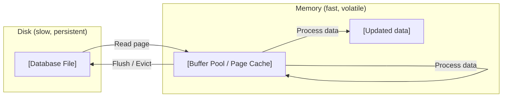

> **Key takeaway:** A buffer is a temporary staging area in memory that lets the
> database avoid repeated, expensive disk reads and batch writes for efficiency.

---

## 2. Buffer Operations: Read, Flush, Release

A simplified buffer in main memory operates over **pages** (fixed-size blocks)
and **files**. The buffer manager supports three core operations:

| Operation        | What it means                                                                 |
|------------------|-------------------------------------------------------------------------------|
| **Read page**    | Load a page from disk into a free frame in the buffer pool.                   |
| **Flush page**   | Evict a page from the buffer **and write its modified contents back to disk** (requires the page to be dirty). |
| **Release page** | Evict a page from the buffer **without writing to disk** (safe only if the page is clean — unmodified). |

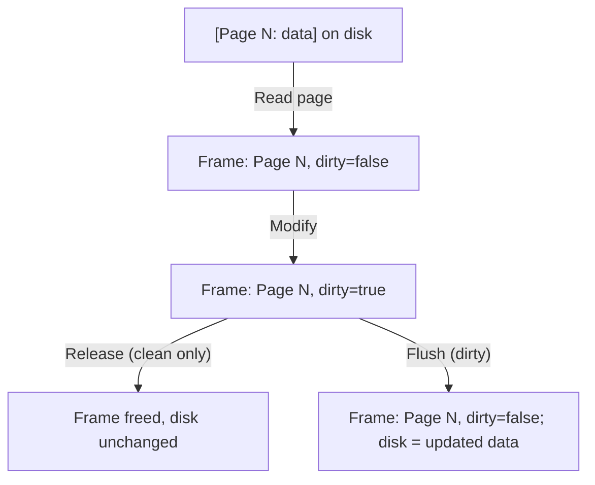

> **Key takeaway:** Every page in the buffer follows a lifecycle — read from
> disk, possibly modified, then either **released** (if clean) or **flushed**
> (if dirty) when it leaves the buffer.

---

## 3. Why the Database Owns Its Buffer

The database maintains its **own buffer** rather than relying entirely on the
operating system's page cache because it knows the access patterns of queries,
transactions, and recovery.

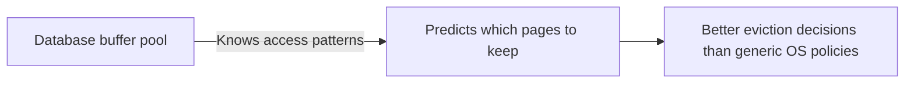

> **Key takeaway:** Because the database understands which pages are hot
> (frequently reused) and which are cold (scan-once), it can make smarter
> replacement decisions than a general-purpose OS page cache.

---

## 4. Buffer Replacement: Why Not FIFO or LIFO?

The database evicts pages based on **recency and frequency of access** (e.g.,
LRU, Clock, or LRU-K) — **not** on simple FIFO or LIFO ordering.

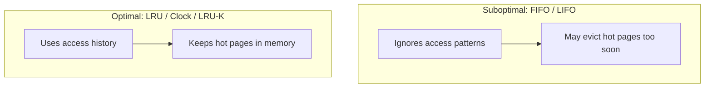

### Sequential Flooding with FIFO

**Scenario:** Buffer pool capacity = 4 pages. A sequential scan reads pages
1, 2, 3, 4, 5, 6, 7, ...

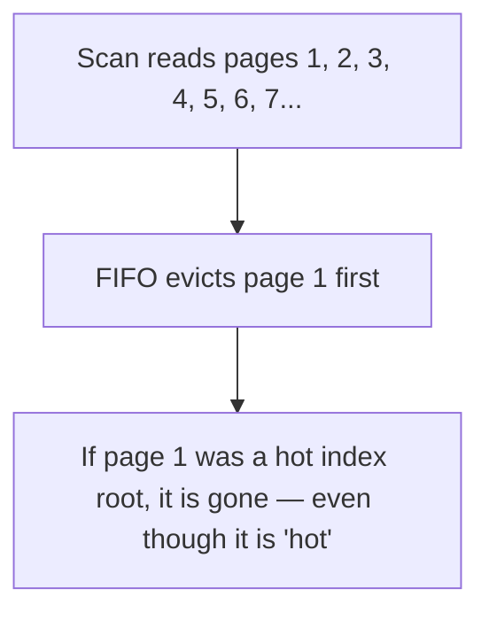

> **Key takeaway:** Access-pattern-aware policies (LRU, Clock, LRU-K) outperform
> FIFO/LIFO because they keep recently and frequently used pages, avoiding the
> sequential-flooding problem.

---

## 5. Recovery and Logging Require Flushing to Disk

The buffer manager's ability to **flush** dirty pages to disk is essential for
two ACID properties:

1. **Durability** — once a transaction commits, its changes must survive a
   crash. The write-ahead log (WAL) is flushed before commit, and dirty data
   pages are eventually flushed too.
2. **Correctness** — during recovery, the DBMS replays the log to redo committed
   transactions and undo uncommitted ones. It must control exactly when dirty
   pages reach stable storage.

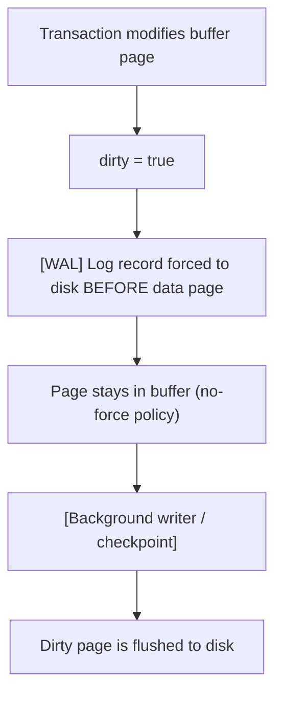

> **Key takeaway:** The database must control flushing because correctness
> depends on the ordering of log records vs. data pages (the write-ahead rule)
> and on knowing which changes have reached stable storage.

---

## 6. MMAP — An Alternative to Explicit Buffer Management

**MMAP** (memory-mapped files) is a POSIX system call that maps a file on disk
directly into a process's virtual address space. After the mapping, reading or
writing to that memory region implicitly reads or writes the file.

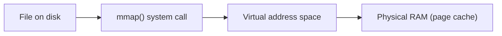

> **Key takeaway:** Mmap lets the OS handle page faults and eviction
> automatically — the application reads and writes pointers as if the file were
> in memory.

---

## 7. Should You Use MMAP in Your DBMS?

This is a cautionary question: **are you sure you want to use mmap in your
database?**

The OS does not understand:

- SQL queries
- Transactions
- Page dependencies and access patterns
- Write-ahead logging ordering requirements
- Which pages are hot vs. scan-only

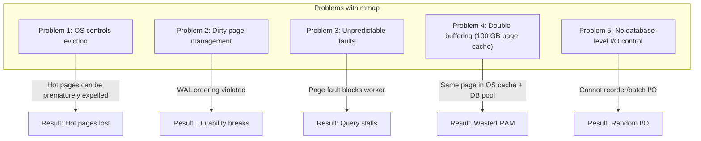

### The Double Buffering Problem (100 GB Page Cache)

When `mmap` reads a file, the data is cached in the OS page cache. The database
**also** maintains its own buffer pool. The same page exists in **two places**
in memory.

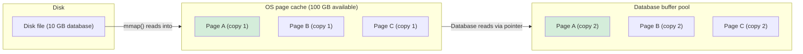

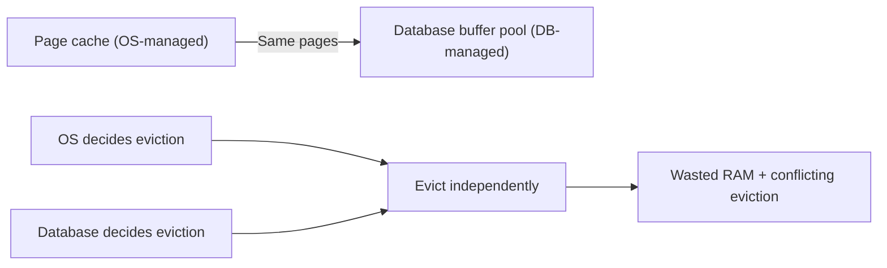

**The problem:** The same 10 GB of data now occupies 20 GB of RAM. If the
database allocated 80 GB for its own buffer pool, only 20 GB remains for other
work — even though 100 GB of physical RAM is available. The OS and the database
fight over the cache, and neither can see the other's decisions.

> **Key takeaway:** Mmap is a powerful convenience but gives up control. Most
> production databases manage their own buffer pools and use explicit I/O rather
> than relying on the OS's virtual memory — partly to avoid double buffering
> (the 100 GB page cache problem), and partly to preserve write-ahead logging,
> eviction, and I/O-scheduling guarantees.

---

## 8. How MMAP Works — The 7-Step Process

The flow from code to memory to disk when using `mmap`:

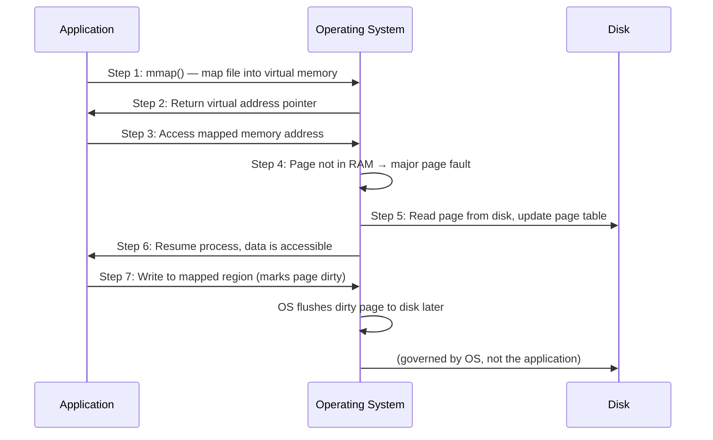

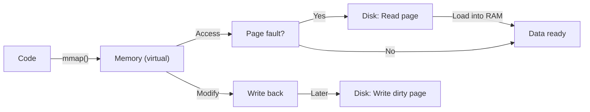

> **Key takeaway:** Mmap collapses the read/write path through the OS page
> cache, but the database forfeits fine-grained control over eviction and write
> ordering.

---

## 9. Pig Latin — Declarative Dataflow on Hadoop

**PIG** is a high-level platform for analyzing large datasets. It provides
**Pig Latin**, a scripting language that expresses data transformations as a
dataflow program. PIG runs on top of **Apache Hadoop** and integrates with
**Apache Hive**.

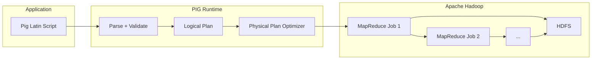

> **Key takeaway:** Pig Latin lets you write high-level transformations
> (LOAD, FILTER, GROUP, JOIN, STORE) without hand-coding MapReduce; the PIG
> runtime compiles them into distributed jobs.

---

## 10. Pig Data Model and Embedded Join Processing

### A Typical Pig Latin Word-Count Script

```pig
raw    = LOAD 'input' USING TextLoader() AS (line:chararray);
parsed = FOREACH raw GENERATE FLATTEN(TOKENIZE(line)) AS word;
grouped = GROUP parsed BY word;
counts  = FOREACH grouped GENERATE group AS word, COUNT(parsed) AS total;
STORE counts INTO 'output';
```

### Embedded Join Processing

**Embedded join processing** means that joins expressed in Pig Latin are
compiled into efficient distributed join strategies (broadcast/replicate-join,
merge-join, or hash-join) that run as part of the MapReduce pipeline. The Pig
runtime decides which physical join to use based on data size and distribution.

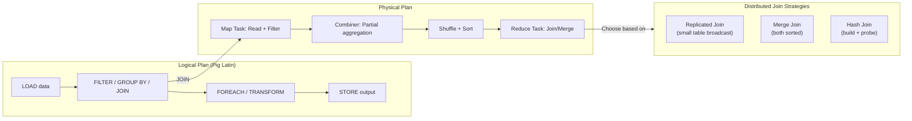

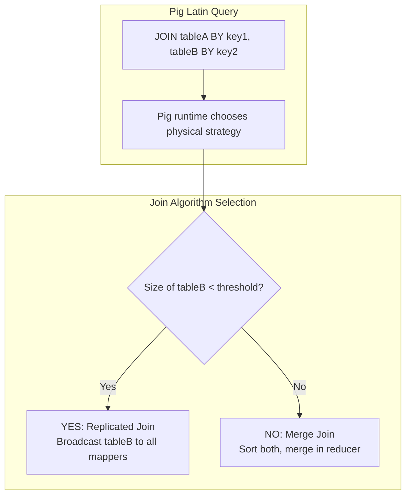

> **Key takeaway:** Pig Latin expresses joins declaratively, and the PIG
> execution engine chooses an appropriate distributed join algorithm — this is
> "embedded join processing."

---

## 11. Indexing to Key-Value Storage

Traditional database indexes (B+ trees, hash indexes) map a **search key** to a
**record identifier (RID)** or the record itself. In a key-value store, this
concept is generalized: every indexed lookup becomes a `key → value` fetch.

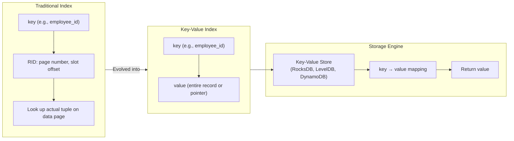

This is how modern storage engines expose indexing: the B+ tree or LSM tree
holds `key → value` pairs, and a range or point query is a point/range lookup on
the key.

### B+ Tree vs. LSM Tree

| Property             | B+ Tree                         | LSM Tree                          |
|----------------------|---------------------------------|-----------------------------------|
| **Write pattern**    | In-place update                 | Append-only log                   |
| **Point query**      | O(log n)                        | O(log n) (may need multiple lookups) |
| **Range query**      | O(log n + k) — excellent        | O(log n + k) — good               |
| **Write throughput** | Moderate                        | High (batched writes)             |
| **Read throughput**  | High                            | Lower (multiple levels to merge)  |
| **Common use**       | PostgreSQL, MySQL (InnoDB)      | RocksDB, Cassandra, LevelDB       |

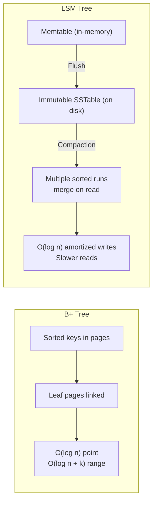

> **Key takeaway:** Indexing in key-value stores reduces to mapping a key to its
> value via B+ trees or LSM trees; understanding these structures bridges
> traditional database indexes and modern NoSQL/document stores.

---

## 12. B+ Trees — The Workhorse Index Structure

The **B+ tree** is the most widely used index structure in production database
systems. It is a balanced, multi-way search tree where all leaf nodes are at the
same depth and contain the indexed keys (or key-to-RID pointers).

### B+ Tree Properties

- **Balanced**: every root-to-leaf path has the same length.
- **Sorted**: keys within each node are in ascending order.
- **High fan-out**: each node can have many children (e.g., 100+), keeping the
  tree shallow.
- **Leaf nodes are linked**: siblings are connected by pointers, enabling
  efficient range scans.

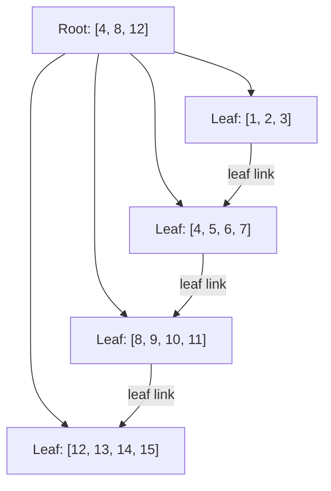

### Search Operation

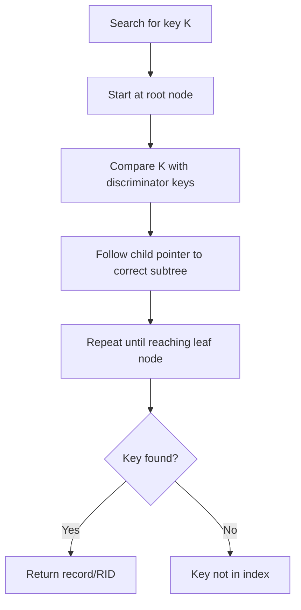

### Insert Operation — Node Split on Overflow

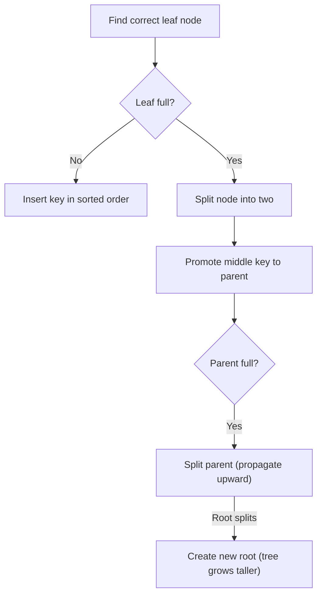

### Delete Operation — Merge on Underflow

```mermaid
flowchart TD
    D1["Find leaf containing key"] --> D2["Remove key from node"]
    D2 --> D3{"Node below min occupancy?"}
    D3 -->|"No"| D4["Done"]
    D3 -->|"Yes"| D5["Try borrow from sibling"]
    D5 --> D6{"Sibling can donate?"}
    D6 -->|"Yes"| D7["Redistribute + update parent"]
    D6 -->|"No"| D8["Merge with sibling"]
    D8 --> D9{"Parent now underfull?"}
    D9 -->|"Yes"| D10["Recursively fix parent"]
    D10 -->|"Root collapsible"| D11["Shrink tree height"]
```

### B+ Tree vs. B Tree

| Feature         | B+ Tree                    | B Tree                        |
|-----------------|----------------------------|-------------------------------|
| Keys in leaf    | Only in leaves             | In internal nodes + leaves    |
| Data storage    | Data (RIDs) in leaves only  | Data can be in internal nodes |
| Node capacity   | Higher (more keys/leaf)     | Lower (data in internal nodes) |
| Range scans     | Excellent (linked leaves)   | Slower (in-order traversal)   |
| Sequential I/O  | Yes (clusters leaves)       | No                            |
| Common use      | Most DBMS (MySQL, PG)       | Filesystems (ReiserFS, NTFS)  |

> **Key takeaway:** B+ trees provide O(log n) point lookups and O(log n + k)
> range queries with balanced, shallow trees and linked leaf nodes — making them
> ideal for both OLTP (fast point lookups) and OLAP (range scans) workloads.

---

## 13. Indexing and Storage: The Full Lookup Path

When the database uses a B+ tree as an index, each leaf entry maps a **search
key** to a **record ID (RID)**. The buffer pool manager then uses the RID to
locate the actual data page.

```mermaid
flowchart TD
    A["SQL: SELECT * FROM Employees WHERE id = 42"] --> B["Query optimizer\nselects index on [id]"]
    B --> C["B+ tree point lookup: id = 42"]
    C -->|"O(log n) descent\nroot to leaf"| D["Leaf entry: (42 → RID: page=105, slot=3)"]
    D --> E["Buffer pool manager:\npage 105 in pool?"]
    E -->|"Yes"| F["Use resident page"]
    E -->|"No"| G["Read page 105 from disk\ninto free buffer frame"]
    F --> H["Fetch tuple at page=105, slot=3"]
    G --> H
    H --> I["Return record to execution engine"]
```

```mermaid
flowchart LR
    A["SQL query"] --> B["Query optimizer\n(chooses index)"]
    B --> C["B+ tree index\n(key → RID)"]
    C --> D["Buffer pool manager\n(RID → page in memory)"]
    D --> E["Disk\n(if page not in buffer)"]
    E --> F["Execution engine\nreceives the tuple"]
```

> **Key takeaway:** Indexes (B+ trees) tell the database **where** a record is
> (via RIDs); the buffer pool manager then ensures the right page is in memory.
> Both layers work together to minimize disk I/O.

---

## 14. I/O-Aware Search: Simple Scan vs. Binary Search

Once a B+ tree node is in memory (loaded via the buffer pool), the database
must search within that node's sorted keys to decide which child pointer to
follow. Two fundamental strategies exist:

1. **Simple (linear) scan** — check every key in the node from left to right.
2. **Binary search** — repeatedly halve the search interval using comparisons.

The choice depends on the interaction between the node's key count, the block
size, and the memory hierarchy (CPU cache, TLB, disk prefetch).

```mermaid
flowchart TD
    subgraph Scan["Simple Scan (Linear)"]
        S1["Start at key[0]"]
        S2["Compare key[i] with target"]
        S3{"key[i] >= target?"}
        S4["i = i + 1"]
        S5["Found position"]
        S1 --> S2 --> S3 -- "No" --> S4 --> S2
        S3 -- "Yes" --> S5
    end

    subgraph Binary["Binary Search"]
        B1["lo = 0, hi = n-1"]
        B2["mid = (lo + hi) / 2"]
        B3["Compare key[mid] with target"]
        B4{"key[mid] vs target"}
        B5["hi = mid - 1"]
        B6["lo = mid + 1"]
        B7["Found position"]
        B1 --> B2 --> B3 --> B4
        B4 -- "target < key[mid]" --> B5 --> B2
        B4 -- "target > key[mid]" --> B6 --> B2
        B4 -- "target == key[mid]" --> B7
    end
```

> **Complexity:**
> - Simple scan: O(n) comparisons, sequential memory access
> - Binary search: O(log n) comparisons, non-sequential (random) memory access

---

## 15. Interaction with Disk I/O Patterns

Both scan and binary search operate on a single node that has already been
loaded into memory. The difference is in **how quickly** the search converges
and how that affects downstream I/O behavior.

```mermaid
flowchart LR
    A["Disk"] -->|"One page read (4 KB block)"| B["Buffer pool frame"]
    B -->|"Node now in memory"| C{"Search within node"}
```

### Cache Behavior Comparison

**Simple scan on a 4 KB node (fits in ~1 cache line):**

```mermaid
flowchart LR
    A["Keys: 1, 2, 3, ..., 50"] --> B["All in same cache line"]
    B --> C["Sequential reads = fast"]
    C --> D["~1 cache miss if not yet loaded"]
```

**Binary search on the same 4 KB node:**

```mermaid
flowchart LR
    A["Jump to key[25] → key[12] → key[6] → key[3]"] --> B["Non-sequential jumps"]
    B --> C["Potential cache misses per jump"]
    C --> D["Up to log₂(50) ≈ 6 cache misses"]
```

> **Key insight:** When the node fits in **one or two cache lines**, the simple
> scan often wins because all keys are already cached after the first access.
> Binary search's logarithmic advantage only matters when n is large enough that
> log₂(n) comparisons save more than the cost of cache misses.

> **Key takeaway:** For small nodes (few keys, fits in 1–2 cache lines), linear
> scan can outperform binary search due to cache locality. For large nodes,
> binary search's O(log n) comparisons typically dominate.

---

## 16. Block Size and Node Capacity

The choice between simple scan and binary search is tightly coupled to the
**block size** (the unit of I/O the database reads from disk) and the **node
capacity** (how many keys fit in one node).

### Typical Values

| Parameter               | Value                              |
|-------------------------|------------------------------------|
| Block / page size       | 4 KB (PostgreSQL, MySQL InnoDB)    |
|                         | 8 KB (some configurations)         |
|                         | 16 KB (Oracle, some PostgreSQL)    |
| Key size (int, 4 bytes) | 4 bytes key + 8 bytes RID ≈ 12 bytes |
| Keys per 4 KB node      | ~341 keys                          |
| Keys per 8 KB node      | ~682 keys                          |
| Keys per 16 KB node     | ~1,365 keys                        |

### Decision Boundary

| Search strategy    | Cost                          | Best when                                     |
|--------------------|-------------------------------|-----------------------------------------------|
| Simple scan        | n comparisons (sequential)    | n ≤ ~50–100, node fits in 1–2 cache lines     |
| Binary search      | log₂(n) comparisons (random)  | n > ~200, node spans multiple cache lines     |

### Worked Example: Node with 341 Keys (4 KB, 12 bytes/key)

```mermaid
flowchart TB
    subgraph Simple["Simple Scan"]
        S1["341 comparisons in worst case"]
        S2["But sequential — all in 4-8 cache lines"]
        S3["Cache hit after first line: ~341 cheap comparisons"]
        S1 --> S2 --> S3
    end
    subgraph Binary["Binary Search"]
        B1["log₂(341) ≈ 9 comparisons in worst case"]
        B2["9 random accesses across 4-8 cache lines"]
        B3["Each miss costs ~100-300 cycles, but only 9 comparisons"]
        B1 --> B2 --> B3
    end
```

> **Key takeaway:** Block size and key size determine node capacity. Binary
> search wins for large nodes (>200 keys); simple scan wins for small nodes
> (≤100 keys) or when the node is already cached.

---

## 17. Memory Hierarchy: L1/L2 Cache, TLB, and Disk Prefetch

The performance of both search strategies is deeply affected by the memory
hierarchy. Every level has different latency and capacity characteristics.

### Latency Numbers Every Engineer Should Know

| Operation            | Approximate latency |
|-----------------------|---------------------|
| L1 cache reference    | ~1 ns               |
| L2 cache reference    | ~4 ns               |
| L3 cache reference    | ~12 ns              |
| Main memory reference | ~100 ns             |
| SSD random read       | ~100 µs             |
| HDD random seek       | ~10 ms              |

```mermaid
flowchart TB
    A["CPU registers"] -->|"~0.3 ns"| B["L1 cache (~32 KB, ~1 ns)"]
    B -->|"~4 ns"| C["L2 cache (~256 KB)"]
    C -->|"~12 ns"| D["L3 cache (~8 MB)"]
    D -->|"~100 ns"| E["Main memory / RAM\n(Buffer pool)"]
    E -->|"~100 µs SSD / ~10 ms HDD"| F["Disk"]
```

### How This Affects Search Strategy

#### 1. CPU Cache Effects

```mermaid
flowchart LR
    subgraph Sequential["Simple Scan — Sequential Access"]
        S1["Keys loaded sequentially into cache"]
        S2["CPU prefetcher predicts next accesses"]
        S3["Cache line reused for consecutive keys"]
    end
    subgraph Random["Binary Search — Random Access"]
        R1["Jump to middle, then quarter, etc."]
        R2["May defeat CPU prefetcher"]
        R3["Potential cache misses per jump"]
    end
```

#### 2. SIMD (Single Instruction, Multiple Data)

Modern CPUs can compare 8 or 16 integers in a single instruction. A SIMD-based
simple scan can check multiple keys at once:

| Method              | Comparisons | Parallel? | Notes                                  |
|---------------------|-------------|-----------|----------------------------------------|
| Simple scan (scalar)| 341         | No        | Sequential, cache-friendly             |
| SIMD scan (AVX-512) | ~22         | Yes       | 16 keys/instruction × 32-bit integers |
| Binary search       | ~9          | No        | Random accesses, potential cache misses|

#### 3. TLB Effects

- **Simple scan**: Sequential memory access → TLB entries are reused.
- **Binary search**: Non-sequential access → potential TLB misses.
- On 4 KB pages, a 4 KB node fits in exactly one TLB entry.

#### 4. Disk Prefetch

```mermaid
flowchart TB
    A["Disk read request\nfor page N"] --> B{"Is sequential scan?"}
    B -->|"Yes"| C["OS issues read-ahead\nprefetch for N+1, N+2..."]
    B -->|"No"| D["Single-page read"]
    C --> E["Adjacent pages cached\nbefore future access needed"]
```

> **Key takeaway:** The memory hierarchy (L1/L2 cache, TLB, prefetch) favors
> sequential access. For nodes already in cache, a SIMD-accelerated simple scan
> can beat binary search. Binary search is better when the node spans cache
> lines and is not resident, because it reduces the number of cache line loads.

---

## 18. Mapping the Concepts Together

Buffer management, MMAP, Pig, and KV indexing all sit along the path from code
to storage. Here is how they relate:

```mermaid
flowchart TD
    A["Application code"] -->|"Pig Latin / SQL"| B["Execution engine"]
    B -->|"Embedded join processing\n(chooses join algorithm)"| C["Query plan\n(uses indexes / KV lookups)"]
    C -->|"Key-value index lookup"| D["Storage engine\n(B+ tree or LSM tree)"]
    D -->|"Read/write pages"| E["Buffer pool manager"]
    E -->|"Read page from disk,\nflush page, release page"| F["Disk file\n(possibly mmap'd by the OS)"]
```

```mermaid
flowchart LR
    subgraph Disk["Disk File Access Options"]
        D1["mmap() — OS-managed virtual mapping"]
        D2["explicit read/write + database buffer pool"]
    end
    D1 -->|"or"| D2
```

```mermaid
flowchart LR
    subgraph Memory["Memory Pages"]
        M1["Buffer replacement:\nLRU / Clock (NOT FIFO or LIFO)"]
    end
    D1["Data loaded from disk"] --> M1
```

```mermaid
flowchart LR
    subgraph Engine["Execution Engine"]
        E1["Embedded join + KV index lookup\n(B+ tree / LSM tree)"]
        E2["Pig Latin / SQL"]
    end
    E1 -->|"Results"| E2
```

> **Key takeaway:** Whether data flows through an OS-managed mmap region or
> through a database-managed buffer pool, and whether indexes are B+ trees or
> LSM trees, the goal is always the same: minimize expensive disk I/O and keep
> the right data in memory at the right time.

---

## 19. Buffer Management and Indexing Cheat Sheet

### Buffer Management

| Concept             | Rule / Formula                                                              |
|---------------------|-----------------------------------------------------------------------------|
| Buffer              | Region of memory storing temporary data (pages)                             |
| Read page           | Load a page from disk into a free buffer frame                              |
| Flush page          | Evict a dirty page — write its contents to disk first                       |
| Release page        | Evict a clean page — no disk write needed                                   |
| Dirty page          | Page modified in memory but not yet written to disk                         |
| Write-ahead rule    | Log record must reach stable storage before the data page is flushed        |
| No-force            | Database need not flush dirty pages before COMMIT (only the log is forced)  |
| Steal              | Buffer manager may evict dirty pages of uncommitted transactions            |
| LRU                  | Evict the least recently used page                                          |
| Clock                | Approximate LRU using a reference bit                                     |
| LRU-K                | Uses K-th most-recent access for better decisions                           |
| Sequential flooding  | Large scans can evict hot pages under naive LRU                             |
| Pin count            | Number of active users — page cannot be evicted if > 0                      |

### MMAP

| Concept             | Rule / Formula                                                |
|---------------------|---------------------------------------------------------------|
| `mmap()`            | Maps a file into the process's virtual address space          |
| Major page fault    | Triggered when the requested page is not yet in RAM           |
| Double buffering    | Same page cached in both OS page cache + DB buffer pool       |
| `fsync()`           | Forces dirty mappings to stable storage                       |

### PIG / Pig Latin

| Concept             | Rule / Formula                                                              |
|---------------------|-----------------------------------------------------------------------------|
| Pig Latin           | Declarative dataflow language (LOAD, FILTER, GROUP, JOIN, FOREACH, STORE)   |
| Embedded join       | Pig compiles joins to distributed map/reduce join algorithms                |
| Runs on             | Apache Hadoop (MapReduce) and integrates with Hive                          |

### Key-Value Indexing and B+ Trees

| Concept             | Rule / Formula                                                              |
|---------------------|-----------------------------------------------------------------------------|
| Key-value store     | Maps key → value (B+ tree or LSM tree backend)                              |
| B+ Tree            | Sorted keys; O(log n) point, O(log n + k) range; linked leaves for scans    |
| LSM Tree            | Sorted runs + memtable; fast writes, slower reads                           |
| Simple scan        | O(n) comparisons; sequential, cache-friendly                                |
| Binary search      | O(log n) comparisons; non-sequential, cache-hostile                         |
| Crossover point    | ~50–200 keys (scan wins below; binary above)                                |
| SIMD scan          | Up to 16 keys per instruction; competitive for moderate n                   |
| Disk prefetch      | Read-ahead helps when node data is accessed sequentially                    |

> **Key takeaway:** Buffer management is about moving pages between disk and
> memory correctly (write-ahead log, no-force, steal). MMAP is an alternative
> that trades control for convenience — and can waste RAM via double buffering.
> Pig Latin and key-value indexes are higher-level abstractions that ultimately
> rely on efficient buffer and storage management underneath. B+ trees are the
> dominant index structure, and choosing between simple scan and binary search
> within tree nodes depends on block size, node capacity, and memory hierarchy
> behavior.
