# Day 9: Buffer Management, MMAP, Pig Latin, and Key-Value Indexing

This class covers four topics that all share a central theme: **how a database or
data-processing system moves data between disk and memory**, and how it
reorganizes or accesses data for speed. We discuss:

- Buffer management (the database's own page cache)
- The pros and cons of using the OS's memory-mapped files (`mmap`)
- The Pig Latin dataflow language that runs on top of Hadoop and Hive
- How traditional indexes map to key-value stores

---

## 1. What Is a Buffer

A **buffer** is a region of physical memory (RAM) used to store temporary data
while it is being moved between a fast and a slow device — typically between
disk and the CPU. In a database context, the **buffer pool** holds pages that
have been read from disk and may be written back later.

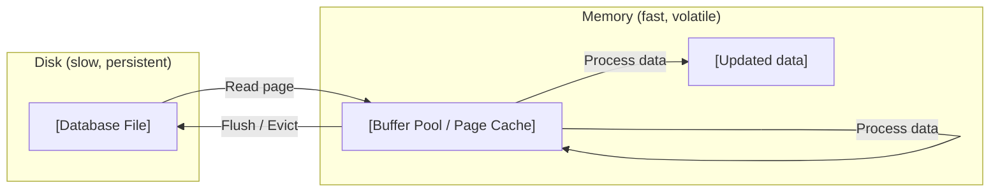

> **Key takeaway:** A buffer is a temporary staging area in memory that lets the
> database avoid repeated, expensive disk reads and batch writes for efficiency.

---

## 2. Buffer Operations: Read, Flush, Release

A simplified buffer in main memory operates over **pages** (fixed-size blocks)
and **files**. The buffer manager supports three core operations:

| Operation        | What it means                                                                 |
|------------------|-------------------------------------------------------------------------------|
| **Read page**    | Load a page from disk into a free frame in the buffer pool.                   |
| **Flush page**   | Evict a page from the buffer **and write its modified contents back to disk** (requires the page to be dirty). |
| **Release page** | Evict a page from the buffer **without writing to disk** (safe only if the page is clean — unmodified). |

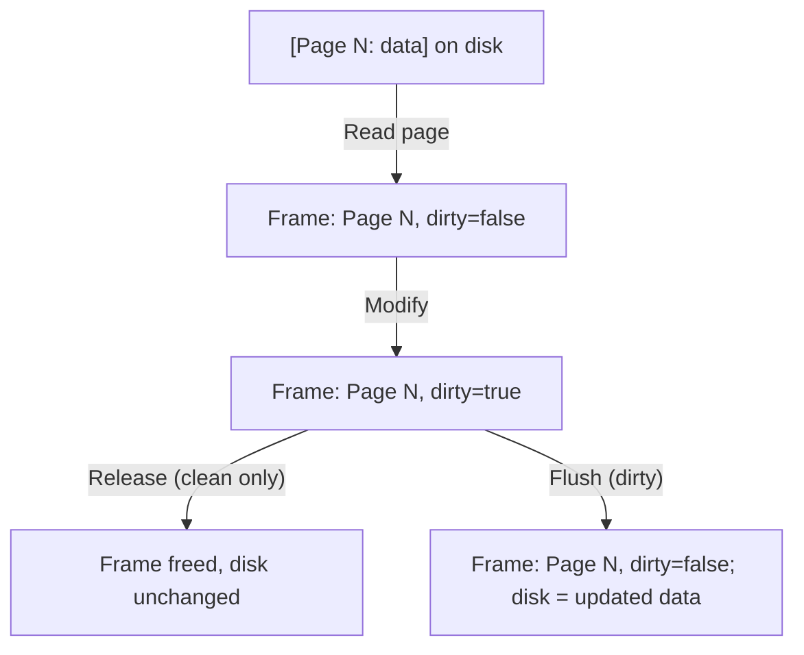

> **Key takeaway:** Every page in the buffer follows a lifecycle — read from
> disk, possibly modified, then either **released** (if clean) or **flushed**
> (if dirty) when it leaves the buffer.

---

## 3. Why the Database Owns Its Buffer

The database maintains its **own buffer** rather than relying entirely on the
operating system's page cache because it knows the access patterns of queries,
transactions, and recovery.


> **Key takeaway:** Because the database understands which pages are hot
> (frequently reused) and which are cold (scan-once), it can make smarter
> replacement decisions than a general-purpose OS page cache.

---

## 4. Buffer Replacement: Why Not FIFO or LIFO?

The database evicts pages based on **recency and frequency of access** (e.g.,
LRU, Clock, or LRU-K) — **not** on simple FIFO or LIFO ordering.


### Sequential Flooding with FIFO

**Scenario:** Buffer pool capacity = 4 pages. A sequential scan reads pages
1, 2, 3, 4, 5, 6, 7, ...

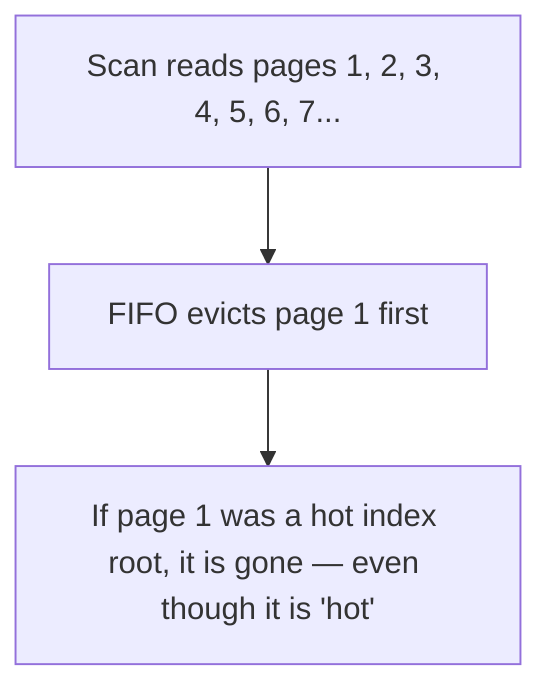

> **Key takeaway:** Access-pattern-aware policies (LRU, Clock, LRU-K) outperform
> FIFO/LIFO because they keep recently and frequently used pages, avoiding the
> sequential-flooding problem.

---

## 5. Recovery and Logging Require Flushing to Disk

The buffer manager's ability to **flush** dirty pages to disk is essential for
two ACID properties:

1. **Durability** — once a transaction commits, its changes must survive a
   crash. The write-ahead log (WAL) is flushed before commit, and dirty data
   pages are eventually flushed too.
2. **Correctness** — during recovery, the DBMS replays the log to redo committed
   transactions and undo uncommitted ones. It must control exactly when dirty
   pages reach stable storage.

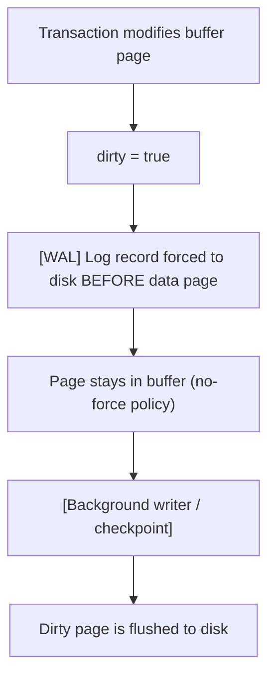

> **Key takeaway:** The database must control flushing because correctness
> depends on the ordering of log records vs. data pages (the write-ahead rule)
> and on knowing which changes have reached stable storage.

---

## 6. MMAP — An Alternative to Explicit Buffer Management

**MMAP** (memory-mapped files) is a POSIX system call that maps a file on disk
directly into a process's virtual address space. After the mapping, reading or
writing to that memory region implicitly reads or writes the file.


> **Key takeaway:** Mmap lets the OS handle page faults and eviction
> automatically — the application reads and writes pointers as if the file were
> in memory.

---

## 7. Should You Use MMAP in Your DBMS?

This is a cautionary question: **are you sure you want to use mmap in your
database?**

The OS does not understand:

- SQL queries
- Transactions
- Page dependencies and access patterns
- Write-ahead logging ordering requirements
- Which pages are hot vs. scan-only

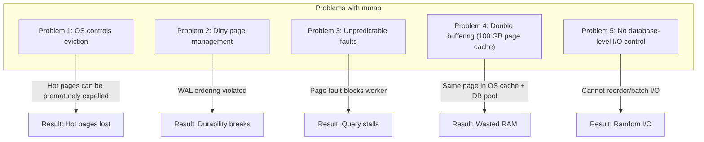

### The Double Buffering Problem (100 GB Page Cache)

When `mmap` reads a file, the data is cached in the OS page cache. The database
**also** maintains its own buffer pool. The same page exists in **two places**
in memory.

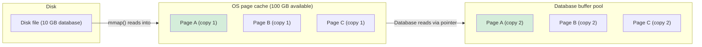

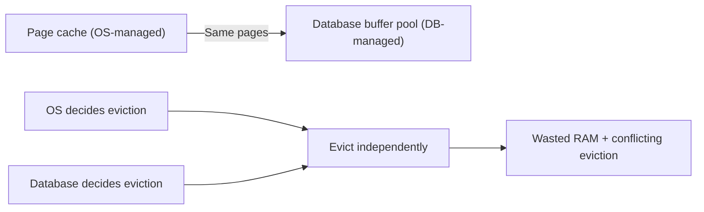

**The problem:** The same 10 GB of data now occupies 20 GB of RAM. If the
database allocated 80 GB for its own buffer pool, only 20 GB remains for other
work — even though 100 GB of physical RAM is available. The OS and the database
fight over the cache, and neither can see the other's decisions.

> **Key takeaway:** Mmap is a powerful convenience but gives up control. Most
> production databases manage their own buffer pools and use explicit I/O rather
> than relying on the OS's virtual memory — partly to avoid double buffering
> (the 100 GB page cache problem), and partly to preserve write-ahead logging,
> eviction, and I/O-scheduling guarantees.

---

## 8. How MMAP Works — The 7-Step Process

The flow from code to memory to disk when using `mmap`:

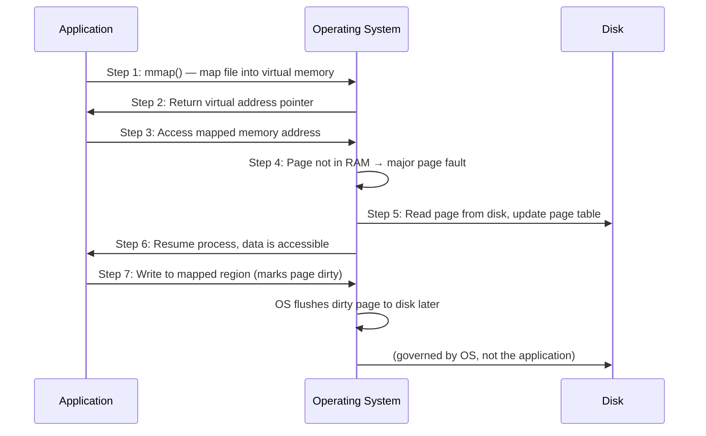

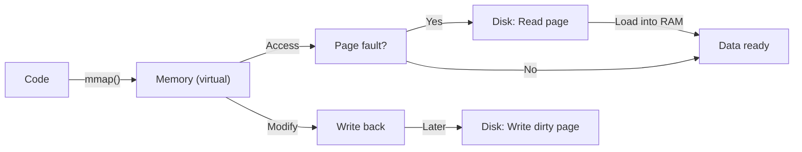

> **Key takeaway:** Mmap collapses the read/write path through the OS page
> cache, but the database forfeits fine-grained control over eviction and write
> ordering.

---

## 9. Pig Latin — Declarative Dataflow on Hadoop

**PIG** is a high-level platform for analyzing large datasets. It provides
**Pig Latin**, a scripting language that expresses data transformations as a
dataflow program. PIG runs on top of **Apache Hadoop** and integrates with
**Apache Hive**.

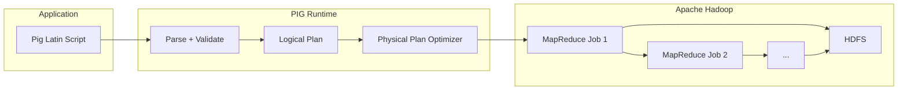

> **Key takeaway:** Pig Latin lets you write high-level transformations
> (LOAD, FILTER, GROUP, JOIN, STORE) without hand-coding MapReduce; the PIG
> runtime compiles them into distributed jobs.

---

## 10. Pig Data Model and Embedded Join Processing

### A Typical Pig Latin Word-Count Script

```pig
raw    = LOAD 'input' USING TextLoader() AS (line:chararray);
parsed = FOREACH raw GENERATE FLATTEN(TOKENIZE(line)) AS word;
grouped = GROUP parsed BY word;
counts  = FOREACH grouped GENERATE group AS word, COUNT(parsed) AS total;
STORE counts INTO 'output';
```

### Embedded Join Processing

**Embedded join processing** means that joins expressed in Pig Latin are
compiled into efficient distributed join strategies (broadcast/replicate-join,
merge-join, or hash-join) that run as part of the MapReduce pipeline. The Pig
runtime decides which physical join to use based on data size and distribution.

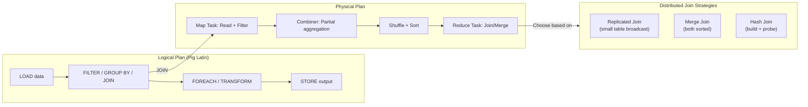

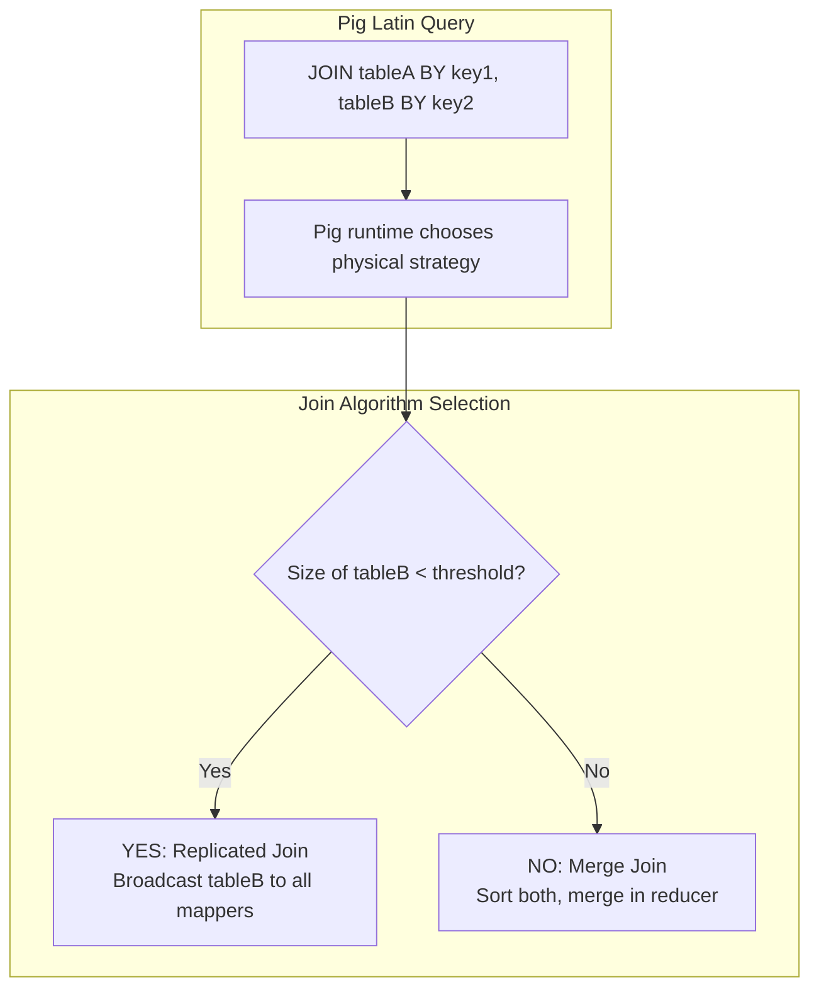

> **Key takeaway:** Pig Latin expresses joins declaratively, and the PIG
> execution engine chooses an appropriate distributed join algorithm — this is
> "embedded join processing."

---

## 11. Indexing to Key-Value Storage

Traditional database indexes (B+ trees, hash indexes) map a **search key** to a
**record identifier (RID)** or the record itself. In a key-value store, this
concept is generalized: every indexed lookup becomes a `key → value` fetch.

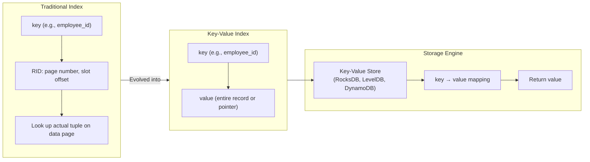

This is how modern storage engines expose indexing: the B+ tree or LSM tree
holds `key → value` pairs, and a range or point query is a point/range lookup on
the key.

### B+ Tree vs. LSM Tree

| Property             | B+ Tree                         | LSM Tree                          |
|----------------------|---------------------------------|-----------------------------------|
| **Write pattern**    | In-place update                 | Append-only log                   |
| **Point query**      | O(log n)                        | O(log n) (may need multiple lookups) |
| **Range query**      | O(log n + k) — excellent        | O(log n + k) — good               |
| **Write throughput** | Moderate                        | High (batched writes)             |
| **Read throughput**  | High                            | Lower (multiple levels to merge)  |
| **Common use**       | PostgreSQL, MySQL (InnoDB)      | RocksDB, Cassandra, LevelDB       |

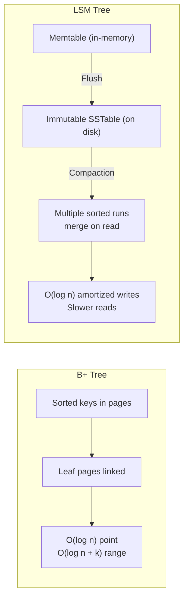

> **Key takeaway:** Indexing in key-value stores reduces to mapping a key to its
> value via B+ trees or LSM trees; understanding these structures bridges
> traditional database indexes and modern NoSQL/document stores.

---

## 12. B+ Trees — The Workhorse Index Structure

The **B+ tree** is the most widely used index structure in production database
systems. It is a balanced, multi-way search tree where all leaf nodes are at the
same depth and contain the indexed keys (or key-to-RID pointers).

### B+ Tree Properties

- **Balanced**: every root-to-leaf path has the same length.
- **Sorted**: keys within each node are in ascending order.
- **High fan-out**: each node can have many children (e.g., 100+), keeping the
  tree shallow.
- **Leaf nodes are linked**: siblings are connected by pointers, enabling
  efficient range scans.

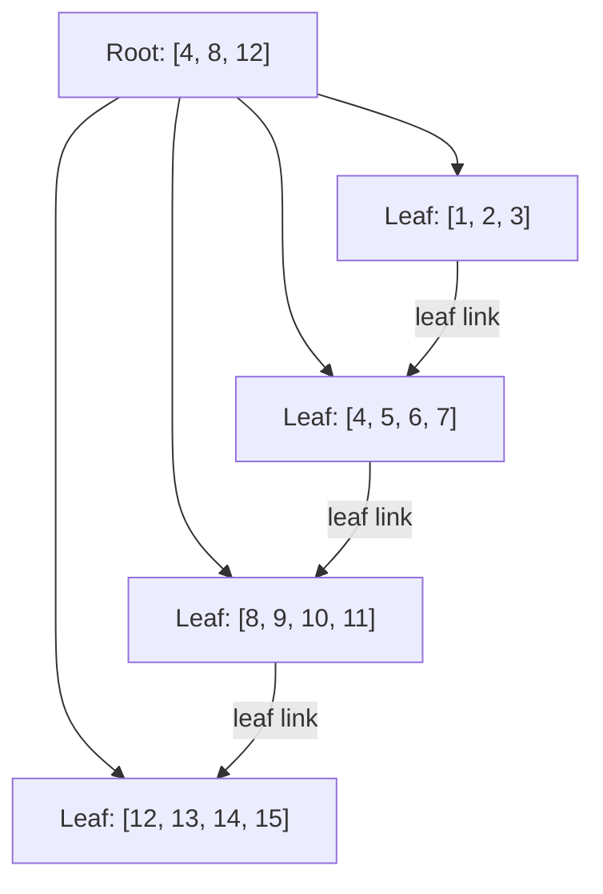

### Search Operation

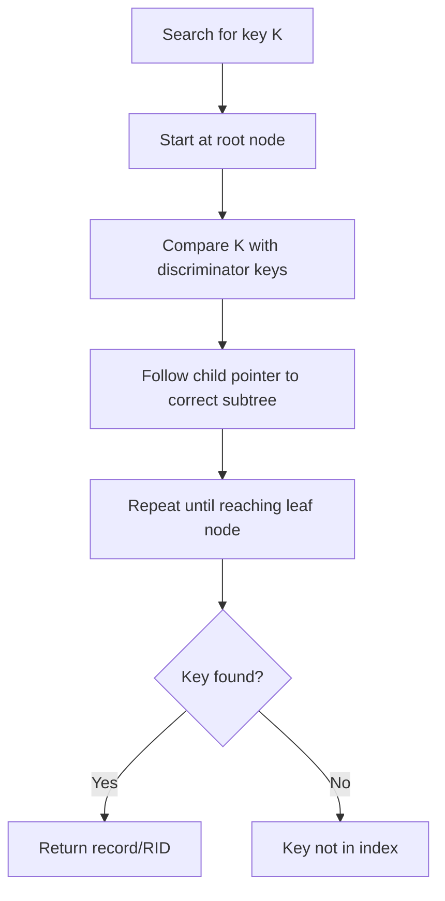

### Insert Operation — Node Split on Overflow

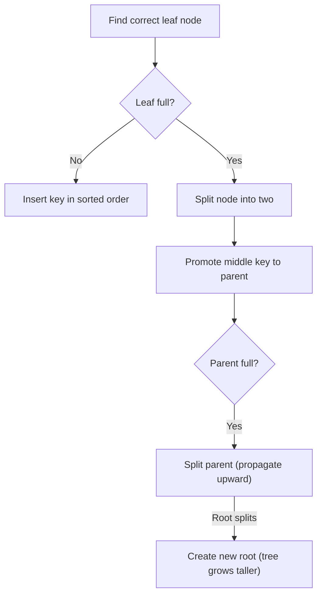

### Delete Operation — Merge on Underflow

```mermaid
flowchart TD
    D1["Find leaf containing key"] --> D2["Remove key from node"]
    D2 --> D3{"Node below min occupancy?"}
    D3 -->|"No"| D4["Done"]
    D3 -->|"Yes"| D5["Try borrow from sibling"]
    D5 --> D6{"Sibling can donate?"}
    D6 -->|"Yes"| D7["Redistribute + update parent"]
    D6 -->|"No"| D8["Merge with sibling"]
    D8 --> D9{"Parent now underfull?"}
    D9 -->|"Yes"| D10["Recursively fix parent"]
    D10 -->|"Root collapsible"| D11["Shrink tree height"]
```

### B+ Tree vs. B Tree

| Feature         | B+ Tree                    | B Tree                        |
|-----------------|----------------------------|-------------------------------|
| Keys in leaf    | Only in leaves             | In internal nodes + leaves    |
| Data storage    | Data (RIDs) in leaves only  | Data can be in internal nodes |
| Node capacity   | Higher (more keys/leaf)     | Lower (data in internal nodes) |
| Range scans     | Excellent (linked leaves)   | Slower (in-order traversal)   |
| Sequential I/O  | Yes (clusters leaves)       | No                            |
| Common use      | Most DBMS (MySQL, PG)       | Filesystems (ReiserFS, NTFS)  |

> **Key takeaway:** B+ trees provide O(log n) point lookups and O(log n + k)
> range queries with balanced, shallow trees and linked leaf nodes — making them
> ideal for both OLTP (fast point lookups) and OLAP (range scans) workloads.

---

## 13. Clustered vs. Unclustered Indexes

An index is **clustered** if the index's key order matches the order in which
the data rows are physically stored on disk. It is **unclustered** (non-clustered)
if the data rows are stored in a different physical order than the index.

### Clustered Index — Data Follows Index Order

```mermaid
flowchart LR
    subgraph Clustered["Clustered Index"]
        direction TB
        C1["Index keys: [3, 7, 12, 19, 25, 30, 35]"]
        C2["Data rows:  [3, 7, 12, 19, 25, 30, 35]"]
        C3["Physical order matches index order"]
    end
    C1 --> C2
    C2 --> C3
```

The leaf pages of a clustered B+ tree **contain the actual data rows**. No
separate lookup is needed — the index IS the table.

### Unclustered Index — Data Follows a Separate Order

```mermaid
flowchart LR
    subgraph Unclustered["Unclustered (Secondary) Index"]
        direction TB
        U1["Index keys: [3, 7, 12, 19, 25, 30, 35]"]
        U2["Data rows:  [25, 3, 30, 7, 12, 19, 35]"]
        U3["Leaf entries: key + RID"]
        U4["Extra lookup via RID"]
    end
    U1 --> U2
    U2 --> U3
    U3 --> U4
```

The leaf pages of an unclustered B+ tree contain **key + RID pointers**.
Finding the actual data row requires a second random I/O.

### Lookup Path Comparison

```mermaid
flowchart TD
    A["SQL: SELECT * FROM Employees WHERE zip = 15213"] --> B["Query optimizer chooses index on [zip]"]

    subgraph ClusteredLookup["Clustered Index Lookup"]
        C1["B+ tree on zip"]
        C2["Leaf page contains\nactual data rows"]
        C3["Return row directly\n(no extra I/O)"]
        C1 --> C2 --> C3
    end

    subgraph UnclusteredLookup["Unclustered Index Lookup"]
        U1["B+ tree on zip"]
        U2["Leaf entry: (15213 → RID: page=105, slot=3)"]
        U3["Follow RID to\ndata page 105"]
        U4["Fetch actual row\n(extra random I/O)"]
        U1 --> U2 --> U3 --> U4
    end

    A --> ClusteredLookup
    A --> UnclusteredLookup
```

### Clustered vs. Unclustered Comparison

| Property        | Clustered                     | Unclustered                    |
|-----------------|-------------------------------|--------------------------------|
| Physical order  | Data sorted by index key      | Data in arbitrary order        |
| Leaf content    | Actual data rows              | Key + RID pointer              |
| # per table     | One (data sorted one way)     | Many (each index is independent) |
| Range scan      | Very fast (sequential I/O)    | Slower (random I/O via RIDs)   |
| Storage overhead| None                          | Extra B+ tree                  |
| Insert overhead | May cause page splits         | Minimal (index-only)           |
| Lookup cost     | O(log n) — data at leaf       | O(log n) + extra page fetch    |

### Architecture Diagram

```mermaid
flowchart LR
    subgraph Disk["On-Disk Layout"]
        direction TB
        D1["Clustered B+ Tree"]
        D2["Root\nInternal nodes\nLeaf = data rows"]
        D3["Unclustered B+ Tree"]
        D4["Root\nInternal nodes\nLeaf = key + RID"]
        D5["Data pages (separate)"]
    end
    D1 --> D2
    D3 --> D4
    D4 -.->|"Follow RID"| D5
    style D2 fill:#e8f5e9
    style D4 fill:#fff3e0
```

> **Key takeaway:** A clustered index stores data rows in the same physical
> order as the index, making range scans extremely efficient at the cost of write
> overhead and limiting the table to one clustered index. An unclustered index
> stores RIDs in the leaf, allowing many indexes per table but requiring an extra
> random I/O per lookup to fetch the actual data page.

### Clustering Key Selection

The choice of which column (or set of columns) becomes the clustered index key
has a lasting impact on performance. A good clustering key is **stable** (rarely
updated), **narrow**, **unique**, and supports common range or sort patterns.

| Criterion        | Why it matters                                                         | Good examples      | Bad examples       |
|---|---|:---:|:---:|
| Stable           | Updates to the key force the row to physically move, causing page splits and expensive writes | Order date, customer ID | Status flags, timestamps updated on every edit |
| Narrow           | The key is stored in **every** unclustered (secondary) index entry, so wide keys bloat all secondary indexes | Single INT, SMALLINT | Wide VARCHAR, composite keys with long strings |
| Unique           | If the key is not unique, the DBMS adds a hidden row-id (e.g., `_rowid` or `ctid`) to every secondary index entry, adding an extra lookup | INT primary key, auto-increment | Duplicate values, non-unique composite keys |
| Sort/range-friendly | Range queries and ORDER BY clauses that match the clustering key scan sequentially | Date ranges, auto-increment IDs | High-cardinality random keys like UUID |

```mermaid
flowchart TD
    A["Choose clustering key"] --> B{"Stable & narrow?"}
    B -->|"No"| C["Bad key: updates cause\npage splits & index bloat"]
    B -->|"Yes"| D{"Supports range\nqueries & ORDER BY?"}
    D -->|"Yes"| E["Good key: fast range\nscans, cheap secondary indexes"]
    D -->|"No"| F["Acceptable, but\nconsider query patterns"]
```

### SQL Syntax for Clustered and Unclustered Indexes

Different database systems expose clustered indexing differently. Here are the
common patterns:

**PostgreSQL** — no explicit `CLUSTERED` keyword on `CREATE INDEX`, but supports
the standalone `CLUSTER` command to physically reorder an existing table:

```sql
-- Re-cluster an existing table on an index
CLUSTER Employees USING idx_zip_code;

-- Or cluster in place (no separate index needed for PK)
CLUSTER Employees USING Employees_pkey;

-- Note: CLUSTER must be re-run periodically as data changes
```

**SQL Server** — explicit `CLUSTERED` / `NONCLUSTERED` keywords:

```sql
-- Clustered index: data rows stored in order of zip_code
CREATE CLUSTERED INDEX ix_zip_clustered
ON Employees(zip_code);

-- Nonclustered index: leaf stores RIDs
CREATE NONCLUSTERED INDEX ix_name_unclustered
ON Employees(last_name);

-- A table can have at most 1 clustered index
```

**MySQL (InnoDB)** — the **primary key** is always the clustered index. No
explicit keyword needed:

```sql
-- InnoDB automatically clusters data on the primary key
CREATE TABLE Employees (
    id       INT PRIMARY KEY,        -- clustered index (data lives in B+ tree leaves)
    zip_code CHAR(5),
    last_name VARCHAR(50),
    INDEX ix_zip (zip_code),          -- secondary, unclustered index
    INDEX ix_name (last_name)         -- secondary, unclustered index
);
```

**MySQL (MyISAM / older engines)** — no clustered indexes; all indexes are
unclustered (leaf stores row pointer).

### Database-Specific Notes

| DBMS          | Clustered index support | Default clustered key | Notes |
|---|---|:---:|---|
| PostgreSQL    | Via `CLUSTER` command (manual, one-time) | None (heap-organized by default) | Table is a heap; `CLUSTER` reorders once. Use `pg_repack` for online reorganization. |
| SQL Server    | Explicit `CLUSTERED` / `NONCLUSTERED` | First column of PK (if defined as CLUSTERED) | Exactly one clustered index per table; secondary indexes store the clustering key instead of a RID. |
| MySQL InnoDB  | Always clustered on PK | The `PRIMARY KEY` | Secondary indexes store the PK value (not a RID), adding a lookup step. If no PK, InnoDB picks a hidden `row_id`. |
| MySQL MyISAM    | None | N/A | All indexes are unclustered; leaf entries store file offsets. |
| Oracle          | Index-organized tables (IOT) | Configurable | `CREATE TABLE ... ORGANIZATION INDEX` makes the table clustered. Otherwise heap-organized. |

### Secondary Indexes on Clustered Tables

An important subtlety: on a table that has a clustered index, **secondary
(unclustered) indexes do not store a physical RID**. Instead, they store the
**clustering key** of the primary row. This means a secondary index lookup
requires two steps:

```mermaid
flowchart TD
    A["SQL: SELECT last_name FROM Employees\nWHERE zip_code = 15213"] --> B["Secondary index on zip_code"]
    B --> C["Leaf entry: zip=15213 → PK id=42"]
    C --> D["Follow PK id=42 to clustered\nB+ tree leaf (actual row)"]
    D --> E["Return row to execution engine"]
```

```text
Step 1: Secondary index lookup    O(log n)
  zip_code = 15213  →  PK = 42

Step 2: Clustered index lookup    O(log n)
  PK = 42  →  actual data row

Total: 2 B+ tree traversals per secondary-index lookup
```

> **Key takeaway:** On a clustered table, secondary indexes use the clustering
> key (not a physical RID) as the pointer. Each secondary lookup is a two-step
> B+ tree traversal. This is why choosing a **narrow, stable** clustering key
> matters for secondary index size.

### Fragmentation and Page Splits

A clustered index keeps rows in sorted order, but **inserts and updates can
break** that order:

- **Page splits** — when a new row must be inserted into a full leaf page, the
  page is split in two. This is expensive: half the rows are moved, the parent
  is updated, and the new pages may not be physically adjacent on disk.
- **External fragmentation** — pages become scattered across the disk, breaking
  sequential I/O.
- **Internal fragmentation** — pages are only partially full after splits,
  wasting space and reducing fan-out.

```mermaid
flowchart LR
    subgraph Before["Before insert (page full)"]
        B1["Page N: [10, 12, 14, 16, 18] — FULL"]
    end
    subgraph After["After page split (insert 13)"]
        A1["Page N: [10, 12]"]
        A2["Page N+1: [13, 14, 16, 18]"]
        A1 -. "physically\nseparate?" -. A2
    end
```

| Maintenance strategy | What it does | Trade-off |
|---|---|---|
| Fill factor    | Leave pages partially empty at creation to absorb inserts | Slower growth, but more wasted space |
| Re-index / rebuild | Drop and recreate the index from scratch | Eliminates fragmentation; requires I/O + locks |
| `CLUSTER` / `pg_repack` | Physically reorder rows on disk | One-time fix; must be repeated as data changes |
| Auto-vacuum (PostgreSQL) | Marks dead tuples for reuse | Reclaims space gradually; does not compact |

> **Key takeaway:** Clustered indexes are fast for range scans but costly to
> maintain. Page splits cause both internal and external fragmentation. Periodic
> re-indexing or clustering is needed to keep performance predictable.

### When to Use Each Type

```text
Range query or ORDER BY?
  |
  Yes → Clustered index on that column (sequential I/O)
  No  → Is the table mostly written?
          |
          Yes → Avoid clustering on a frequently-updated column
          No  → Cluster on the most common query key

Need many indexes on the same table?
  |
  → One clustered index (on the best range/sort key)
  → Plus multiple unclustered indexes (for other search patterns)
```

| Workload                | Recommended approach |
|---|---|
| Range scans (`WHERE date BETWEEN ...`) | Clustered on `date` |
| Frequent updates to the key | Unclustered (avoids page splits) |
| Sequential inserts (append-only) | Clustered on an auto-increment key |
| OLTP with random inserts | Cluster on an ever-increasing key (ID, timestamp) |
| OLAP with large sorts | Clustered on the sort column |
| Many secondary lookups | Keep the clustering key narrow and unique |

> **Key takeaway:** Cluster on the column that benefits most from sequential I/O
> (range scans, ORDER BY), keeping it stable, narrow, and unique. Use
> unclustered indexes for everything else. When in doubt, cluster on an
> auto-increment surrogate key — it's stable, narrow, and append-friendly.

---

## 14. Indexing and Storage: The Full Lookup Path

When the database uses a B+ tree as an index, each leaf entry maps a **search
key** to a **record ID (RID)**. The buffer pool manager then uses the RID to
locate the actual data page.

```mermaid
flowchart TD
    A["SQL: SELECT * FROM Employees WHERE id = 42"] --> B["Query optimizer\nselects index on [id]"]
    B --> C["B+ tree point lookup: id = 42"]
    C -->|"O(log n) descent\nroot to leaf"| D["Leaf entry: (42 → RID: page=105, slot=3)"]
    D --> E["Buffer pool manager:\npage 105 in pool?"]
    E -->|"Yes"| F["Use resident page"]
    E -->|"No"| G["Read page 105 from disk\ninto free buffer frame"]
    F --> H["Fetch tuple at page=105, slot=3"]
    G --> H
    H --> I["Return record to execution engine"]
```

```mermaid
flowchart LR
    A["SQL query"] --> B["Query optimizer\n(chooses index)"]
    B --> C["B+ tree index\n(key → RID)"]
    C --> D["Buffer pool manager\n(RID → page in memory)"]
    D --> E["Disk\n(if page not in buffer)"]
    E --> F["Execution engine\nreceives the tuple"]
```

> **Key takeaway:** Indexes (B+ trees) tell the database **where** a record is
> (via RIDs); the buffer pool manager then ensures the right page is in memory.
> Both layers work together to minimize disk I/O.

---

## 15. I/O-Aware Search: Simple Scan vs. Binary Search

Once a B+ tree node is in memory (loaded via the buffer pool), the database
must search within that node's sorted keys to decide which child pointer to
follow. Two fundamental strategies exist:

1. **Simple (linear) scan** — check every key in the node from left to right.
2. **Binary search** — repeatedly halve the search interval using comparisons.

The choice depends on the interaction between the node's key count, the block
size, and the memory hierarchy (CPU cache, TLB, disk prefetch).

```mermaid
flowchart TD
    subgraph Scan["Simple Scan (Linear)"]
        S1["Start at key[0]"]
        S2["Compare key[i] with target"]
        S3{"key[i] >= target?"}
        S4["i = i + 1"]
        S5["Found position"]
        S1 --> S2 --> S3 -- "No" --> S4 --> S2
        S3 -- "Yes" --> S5
    end

    subgraph Binary["Binary Search"]
        B1["lo = 0, hi = n-1"]
        B2["mid = (lo + hi) / 2"]
        B3["Compare key[mid] with target"]
        B4{"key[mid] vs target"}
        B5["hi = mid - 1"]
        B6["lo = mid + 1"]
        B7["Found position"]
        B1 --> B2 --> B3 --> B4
        B4 -- "target < key[mid]" --> B5 --> B2
        B4 -- "target > key[mid]" --> B6 --> B2
        B4 -- "target == key[mid]" --> B7
    end
```

> **Complexity:**
> - Simple scan: O(n) comparisons, sequential memory access
> - Binary search: O(log n) comparisons, non-sequential (random) memory access

---

## 16. Interaction with Disk I/O Patterns

Both scan and binary search operate on a single node that has already been
loaded into memory. The difference is in **how quickly** the search converges
and how that affects downstream I/O behavior.

```mermaid
flowchart LR
    A["Disk"] -->|"One page read (4 KB block)"| B["Buffer pool frame"]
    B -->|"Node now in memory"| C{"Search within node"}
```

### Cache Behavior Comparison

**Simple scan on a 4 KB node (fits in ~1 cache line):**

```mermaid
flowchart LR
    A["Keys: 1, 2, 3, ..., 50"] --> B["All in same cache line"]
    B --> C["Sequential reads = fast"]
    C --> D["~1 cache miss if not yet loaded"]
```

**Binary search on the same 4 KB node:**

```mermaid
flowchart LR
    A["Jump to key[25] → key[12] → key[6] → key[3]"] --> B["Non-sequential jumps"]
    B --> C["Potential cache misses per jump"]
    C --> D["Up to log₂(50) ≈ 6 cache misses"]
```

> **Key insight:** When the node fits in **one or two cache lines**, the simple
> scan often wins because all keys are already cached after the first access.
> Binary search's logarithmic advantage only matters when n is large enough that
> log₂(n) comparisons save more than the cost of cache misses.

> **Key takeaway:** For small nodes (few keys, fits in 1–2 cache lines), linear
> scan can outperform binary search due to cache locality. For large nodes,
> binary search's O(log n) comparisons typically dominate.

---

## 17. Block Size and Node Capacity

The choice between simple scan and binary search is tightly coupled to the
**block size** (the unit of I/O the database reads from disk) and the **node
capacity** (how many keys fit in one node).

### Typical Values

| Parameter               | Value                              |
|-------------------------|------------------------------------|
| Block / page size       | 4 KB (PostgreSQL, MySQL InnoDB)    |
|                         | 8 KB (some configurations)         |
|                         | 16 KB (Oracle, some PostgreSQL)    |
| Key size (int, 4 bytes) | 4 bytes key + 8 bytes RID ≈ 12 bytes |
| Keys per 4 KB node      | ~341 keys                          |
| Keys per 8 KB node      | ~682 keys                          |
| Keys per 16 KB node     | ~1,365 keys                        |

### Decision Boundary

| Search strategy    | Cost                          | Best when                                     |
|--------------------|-------------------------------|-----------------------------------------------|
| Simple scan        | n comparisons (sequential)    | n ≤ ~50–100, node fits in 1–2 cache lines     |
| Binary search      | log₂(n) comparisons (random)  | n > ~200, node spans multiple cache lines     |

### Worked Example: Node with 341 Keys (4 KB, 12 bytes/key)

```mermaid
flowchart TB
    subgraph Simple["Simple Scan"]
        S1["341 comparisons in worst case"]
        S2["But sequential — all in 4-8 cache lines"]
        S3["Cache hit after first line: ~341 cheap comparisons"]
        S1 --> S2 --> S3
    end
    subgraph Binary["Binary Search"]
        B1["log₂(341) ≈ 9 comparisons in worst case"]
        B2["9 random accesses across 4-8 cache lines"]
        B3["Each miss costs ~100-300 cycles, but only 9 comparisons"]
        B1 --> B2 --> B3
    end
```

> **Key takeaway:** Block size and key size determine node capacity. Binary
> search wins for large nodes (>200 keys); simple scan wins for small nodes
> (≤100 keys) or when the node is already cached.

---

## 18. Memory Hierarchy: L1/L2 Cache, TLB, and Disk Prefetch

The performance of both search strategies is deeply affected by the memory
hierarchy. Every level has different latency and capacity characteristics.

### Latency Numbers Every Engineer Should Know

| Operation            | Approximate latency |
|-----------------------|---------------------|
| L1 cache reference    | ~1 ns               |
| L2 cache reference    | ~4 ns               |
| L3 cache reference    | ~12 ns              |
| Main memory reference | ~100 ns             |
| SSD random read       | ~100 µs             |
| HDD random seek       | ~10 ms              |

```mermaid
flowchart TB
    A["CPU registers"] -->|"~0.3 ns"| B["L1 cache (~32 KB, ~1 ns)"]
    B -->|"~4 ns"| C["L2 cache (~256 KB)"]
    C -->|"~12 ns"| D["L3 cache (~8 MB)"]
    D -->|"~100 ns"| E["Main memory / RAM\n(Buffer pool)"]
    E -->|"~100 µs SSD / ~10 ms HDD"| F["Disk"]
```

### How This Affects Search Strategy

#### 1. CPU Cache Effects

```mermaid
flowchart LR
    subgraph Sequential["Simple Scan — Sequential Access"]
        S1["Keys loaded sequentially into cache"]
        S2["CPU prefetcher predicts next accesses"]
        S3["Cache line reused for consecutive keys"]
    end
    subgraph Random["Binary Search — Random Access"]
        R1["Jump to middle, then quarter, etc."]
        R2["May defeat CPU prefetcher"]
        R3["Potential cache misses per jump"]
    end
```

#### 2. SIMD (Single Instruction, Multiple Data)

Modern CPUs can compare 8 or 16 integers in a single instruction. A SIMD-based
simple scan can check multiple keys at once:

| Method              | Comparisons | Parallel? | Notes                                  |
|---------------------|-------------|-----------|----------------------------------------|
| Simple scan (scalar)| 341         | No        | Sequential, cache-friendly             |
| SIMD scan (AVX-512) | ~22         | Yes       | 16 keys/instruction × 32-bit integers |
| Binary search       | ~9          | No        | Random accesses, potential cache misses|

#### 3. TLB Effects

- **Simple scan**: Sequential memory access → TLB entries are reused.
- **Binary search**: Non-sequential access → potential TLB misses.
- On 4 KB pages, a 4 KB node fits in exactly one TLB entry.

#### 4. Disk Prefetch

```mermaid
flowchart TB
    A["Disk read request\nfor page N"] --> B{"Is sequential scan?"}
    B -->|"Yes"| C["OS issues read-ahead\nprefetch for N+1, N+2..."]
    B -->|"No"| D["Single-page read"]
    C --> E["Adjacent pages cached\nbefore future access needed"]
```

> **Key takeaway:** The memory hierarchy (L1/L2 cache, TLB, prefetch) favors
> sequential access. For nodes already in cache, a SIMD-accelerated simple scan
> can beat binary search. Binary search is better when the node spans cache
> lines and is not resident, because it reduces the number of cache line loads.

---

## 19. Mapping the Concepts Together

Buffer management, MMAP, Pig, and KV indexing all sit along the path from code
to storage. Here is how they relate:

```mermaid
flowchart TD
    A["Application code"] -->|"Pig Latin / SQL"| B["Execution engine"]
    B -->|"Embedded join processing\n(chooses join algorithm)"| C["Query plan\n(uses indexes / KV lookups)"]
    C -->|"Key-value index lookup"| D["Storage engine\n(B+ tree or LSM tree)"]
    D -->|"Read/write pages"| E["Buffer pool manager"]
    E -->|"Read page from disk,\nflush page, release page"| F["Disk file\n(possibly mmap'd by the OS)"]
```

```mermaid
flowchart LR
    subgraph Disk["Disk File Access Options"]
        D1["mmap() — OS-managed virtual mapping"]
        D2["explicit read/write + database buffer pool"]
    end
    D1 -->|"or"| D2
```

```mermaid
flowchart LR
    subgraph Memory["Memory Pages"]
        M1["Buffer replacement:\nLRU / Clock (NOT FIFO or LIFO)"]
    end
    D1["Data loaded from disk"] --> M1
```

```mermaid
flowchart LR
    subgraph Engine["Execution Engine"]
        E1["Embedded join + KV index lookup\n(B+ tree / LSM tree)"]
        E2["Pig Latin / SQL"]
    end
    E1 -->|"Results"| E2
```

> **Key takeaway:** Whether data flows through an OS-managed mmap region or
> through a database-managed buffer pool, and whether indexes are B+ trees or
> LSM trees, the goal is always the same: minimize expensive disk I/O and keep
> the right data in memory at the right time.

---

## 20. Buffer Management and Indexing Cheat Sheet

### Buffer Management

| Concept             | Rule / Formula                                                              |
|---------------------|-----------------------------------------------------------------------------|
| Buffer              | Region of memory storing temporary data (pages)                             |
| Read page           | Load a page from disk into a free buffer frame                              |
| Flush page          | Evict a dirty page — write its contents to disk first                       |
| Release page        | Evict a clean page — no disk write needed                                   |
| Dirty page          | Page modified in memory but not yet written to disk                         |
| Write-ahead rule    | Log record must reach stable storage before the data page is flushed        |
| No-force            | Database need not flush dirty pages before COMMIT (only the log is forced)  |
| Steal              | Buffer manager may evict dirty pages of uncommitted transactions            |
| LRU                  | Evict the least recently used page                                          |
| Clock                | Approximate LRU using a reference bit                                     |
| LRU-K                | Uses K-th most-recent access for better decisions                           |
| Sequential flooding  | Large scans can evict hot pages under naive LRU                             |
| Pin count            | Number of active users — page cannot be evicted if > 0                      |

### MMAP

| Concept             | Rule / Formula                                                |
|---------------------|---------------------------------------------------------------|
| `mmap()`            | Maps a file into the process's virtual address space          |
| Major page fault    | Triggered when the requested page is not yet in RAM           |
| Double buffering    | Same page cached in both OS page cache + DB buffer pool       |
| `fsync()`           | Forces dirty mappings to stable storage                       |

### PIG / Pig Latin

| Concept             | Rule / Formula                                                              |
|---------------------|-----------------------------------------------------------------------------|
| Pig Latin           | Declarative dataflow language (LOAD, FILTER, GROUP, JOIN, FOREACH, STORE)   |
| Embedded join       | Pig compiles joins to distributed map/reduce join algorithms                |
| Runs on             | Apache Hadoop (MapReduce) and integrates with Hive                          |

### Key-Value Indexing and B+ Trees

| Concept             | Rule / Formula                                                              |
|---------------------|-----------------------------------------------------------------------------|
| Key-value store     | Maps key → value (B+ tree or LSM tree backend)                              |
| B+ Tree            | Sorted keys; O(log n) point, O(log n + k) range; linked leaves for scans    |
| LSM Tree            | Sorted runs + memtable; fast writes, slower reads                           |
| Simple scan        | O(n) comparisons; sequential, cache-friendly                                |
| Binary search      | O(log n) comparisons; non-sequential, cache-hostile                         |
| Crossover point    | ~50–200 keys (scan wins below; binary above)                                |
| SIMD scan          | Up to 16 keys per instruction; competitive for moderate n                   |
| Disk prefetch      | Read-ahead helps when node data is accessed sequentially                    |

### Clustered and Unclustered Indexes

| Concept             | Rule / Formula                                                              |
|---|---|
| Clustered index     | Data rows stored in same physical order as index key; leaf = data           |
| Unclustered index   | Leaf stores key + RID; data in arbitrary order                              |
| # per table         | 1 clustered; many unclustered                                               |
| Clustering key      | Choose: stable, narrow, unique, sort/range-friendly                         |
| Secondary on clustered | Stores clustering key (not RID) → 2 B+ tree lookups                      |
| Page split          | Inserts into full pages split nodes; causes fragmentation                   |
| CLUSTER (PostgreSQL)| One-time physical reorder of table rows on disk                             |
| CLUSTERED (SQL Server)| `CREATE CLUSTERED INDEX`; at most 1 per table                             |
| InnoDB              | PK is always the clustered index; secondary indexes store PK value          |

> **Key takeaway:** Buffer management is about moving pages between disk and
> memory correctly (write-ahead log, no-force, steal). MMAP is an alternative
> that trades control for convenience — and can waste RAM via double buffering.
> Pig Latin and key-value indexes are higher-level abstractions that ultimately
> rely on efficient buffer and storage management underneath. B+ trees are the
> dominant index structure, and choosing between simple scan and binary search
> within tree nodes depends on block size, node capacity, and memory hierarchy
> behavior.

---

## 21. External Merge Sort

When the data to be sorted does not fit in main memory, a database or
data-processing system must sort using **external sorting** — the data lives on
disk and is streamed through memory in chunks. **External merge sort** is the most
general external sorting algorithm, and it builds directly on the buffer and I/O
concepts discussed throughout these notes: disk I/O dominates, pages move through
the buffer pool, and the goal is always to minimize expensive reads and writes.

### Concept Overview

The core challenge is **merging large files when memory is limited**. The input
files may be far larger than available RAM, so the algorithm processes data in
**pages** or **runs** that are small enough to fit in memory.

**Disk I/O (read and write) is the dominant factor in performance.** CPU
comparisons are essentially free by comparison — a single disk seek costs millions
of CPU cycles. The algorithm therefore aims to **minimize the number of passes**
over the data and to make every I/O count.

### Algorithmic Parameters

Every external merge operation is defined by three parameters:

| Parameter        | Description                                                                    |
|------------------|-------------------------------------------------------------------------------|
| **Input**        | Two sorted input files (runs) of sizes M and N records respectively.          |
| **Output**       | A single sorted output file containing all M + N records, written to disk.    |
| **Requirements** | Memory must hold at least **three pages**: one per input run, plus one output buffer. |

### Complexity Analysis

The I/O cost of merging two sorted runs is expressed as **2(M + N)**:

- **M + N reads** — every record from both input files must be read at least once.
- **M + N writes** — every record must be written to the output file.

Total I/O = (M + N) reads + (M + N) writes = **2(M + N)**.

```text
I/O breakdown:

  Input file A: [a_1, a_2, ..., a_M]      →  M reads
  Input file B: [b_1, b_2, ..., b_N]      →  N reads
  Output file:  [c_1, c_2, ..., c_{M+N}]   →  M + N writes

                      M reads + N reads + (M + N) writes
                           = 2(M + N) I/O operations
```

> **Note:** This is the cost of a **single merge pass**. A full external sort
> compounds this factor by the number of merge passes, but each pass still costs
> 2(M + N).

### Core Logic — Merging Sorted Sequences

The merge operation relies on a fundamental invariant: **both input sequences are
already sorted**. If the first input has
$a_1 \leq a_2 \leq \dots \leq a_M$ and the second has
$b_1 \leq b_2 \leq \dots \leq b_N$, the merged output
$c_1 \leq c_2 \leq \dots \leq c_{M+N}$ can be produced by a single
left-to-right comparison walk:

```text
  a_1 ≤ a_2 ≤ ... ≤ a_M         b_1 ≤ b_2 ≤ ... ≤ b_N
         \                      /
          \   Compare heads   /
           \                  /
            v                v
          c_1 ≤ c_2 ≤ ... ≤ c_{M+N}
```

At each step, the smaller of the two current heads is appended to the output, and
the corresponding input advances by one. Because each sequence is sorted, once an
element is chosen it can never be overtaken by a later element from the same
sequence — the pointer never backtracks.

### Visual Representation — Step-by-Step Merge

Consider merging two sorted runs:

- **Run A** = `[3, 7, 12, 20]` (M = 4)
- **Run B** = `[1, 5, 15, 25, 30]` (N = 5)

```text
Step 1:  A:[3, 7, 12, 20]     B:[1, 5, 15, 25, 30]   Output:[]
           ↑                    ↑
         Compare 3 vs 1 → 1 smaller, append to output

Step 2:  A:[3, 7, 12, 20]     B:[1, 5, 15, 25, 30]   Output:[1]
                  ↑                  ↑
            Compare 3 vs 5 → 3 smaller, append to output

Step 3:  A:[3, 7, 12, 20]     B:[1, 5, 15, 25, 30]   Output:[1, 3]
                    ↑                    ↑
              Compare 7 vs 5 → 5 smaller, append to output

Step 4:  A:[3, 7, 12, 20]     B:[1, 5, 15, 25, 30]   Output:[1, 3, 5]
                      ↑                      ↑
                Compare 7 vs 15 → 7 smaller, append to output

  ... continue until both runs are exhausted ...

Final:  Output:[1, 3, 5, 7, 12, 15, 20, 25, 30]
```

#### Merge Process Diagram

```mermaid
flowchart TD
    subgraph TwoRuns["Two Sorted Runs (on disk)"]
        RA["Run A<br/>a_1 ≤ a_2 ≤ ... ≤ a_M"]
        RB["Run B<br/>b_1 ≤ b_2 ≤ ... ≤ b_N"]
    end

    subgraph InMem["In-Memory Buffers"]
        BA["Buffer A<br/>head = a_i"]
        BB["Buffer B<br/>head = b_j"]
        OB["Output buffer<br/>c_1, c_2, ..."]
    end

    subgraph DiskOut["Output File (on disk)"]
        OUT["Merged output<br/>c_1 ≤ c_2 ≤ ... ≤ c_{M+N}"]
    end

    RA -- "read page" --> BA
    RB -- "read page" --> BB
    BA <-->|"compare a_i, b_j"| BB
    BA -->|"append smaller"| OB
    BB -->|"append smaller"| OB
    OB -- "flush when<br/>buffer full" --> OUT

    style RA fill:#e3f2fd
    style RB fill:#e3f2fd
    style OUT fill:#e8f5e9
```

#### Merge Algorithm Flow

```mermaid
flowchart LR
    A["Start<br/>i = 0, j = 0"] --> B{"i < M<br/>AND j < N?"}
    B -- "Yes" --> C["Compare a[i] vs b[j]"]
    C --> D{"a[i] ≤ b[j]?"}
    D -- "Yes" --> E["Append a[i] to output<br/>i = i + 1"]
    D -- "No" --> F["Append b[j] to output<br/>j = j + 1"]
    E --> B
    F --> B
    B -- "No" --> G["Append remaining<br/>elements from non-empty run"]
    G --> H["Done — M+N records merged<br/>2(M+N) I/Os total"]
```

### Full External Sort Pipeline

Merging two runs is one step. A complete external sort operates in two phases:

```mermaid
flowchart TD
    A["Phase 1: Sort (in-memory)"] -->|"Read chunks of size M that fit<br/>in RAM. Sort each in memory.<br/>Write sorted run to disk."| B["Sorted runs:<br/>R_1, R_2, ..., R_r"]
    B --> C["Phase 2: Merge (on disk)"]
    C -->|"Repeatedly merge k sorted runs<br/>at a time, each pass costing<br/>2(M+N) I/Os. Write merged<br/>output back to disk."| D["Single fully sorted<br/>output file"]

    style A fill:#fff3e0
    style C fill:#fff3e0
    style D fill:#e8f5e9
```

| Phase           | What happens                                              | I/O cost                |
|-----------------|-----------------------------------------------------------|-------------------------|
| **Sort phase**  | Read each chunk from disk; sort in memory; write run to disk. | 2N (read + write once) |
| **Merge phase** | Merge sorted runs k-at-a-time; each pass costs 2(M + N).  | 2N per pass            |
| **Total**       | With k-way merge, passes ≈ ⌈log_k r⌉ where r = initial runs. | O(N · log r) passes    |

> **Key takeaway:** External merge sort is the foundation for sorting datasets
> that exceed main memory. By splitting input into sorted runs and merging them
> with a comparison walk, the algorithm produces sorted output with predictable
> I/O cost. Disk I/O is the dominant cost: each merge pass costs **2(M + N)** —
> every record is read and written once — and the total cost scales with the
> number of passes. Minimizing passes (via larger buffers or higher merge fan-in
> k) is the key performance lever.

---

## 22. External Merge Sort — The (B+1) Page Buffer Strategy

The **(B+1) page buffer strategy** is the key optimization that makes external
merge sort practical for very large datasets. It exploits available memory to
maximize merge fan-in — the number of sorted runs that can be merged in a single
pass — thereby reducing the total number of passes over the data.

### How It Works

With **B + 1** buffer pages available in main memory:

- **B pages** serve as **input buffers** — one per sorted run being merged.
- **1 page** serves as the **output buffer** — accumulated results are written to
  disk when full.

This arrangement enables a **B-way merge**: B sorted runs are merged
simultaneously into one output run.

### Packaging Phase (Run Creation)

In the **packaging phase**, the input file (N pages total) is divided into chunks
of B pages each. Each chunk is loaded into memory, sorted using an in-memory
algorithm, and written back to disk as a **sorted run**.

- **Pages read per run**: B
- **Pages written per run**: B
- **Number of initial runs**: $\lceil N / B \rceil$
- **I/O cost**: 2N (one full read + one full write of the entire file)

```text
Phase 1: Packaging (Run Creation)

  Disk file (N pages)
    |
    | Chunk 1: B pages   ->  sort in memory  ->  write sorted run R_1
    | Chunk 2: B pages   ->  sort in memory  ->  write sorted run R_2
    | ...                                        ...
    | Chunk k: B pages   ->  sort in memory  ->  write sorted run R_k
    v

  Sorted runs on disk: R_1, R_2, ..., R_{ceil(N/B)}
  Each run: B pages, internally sorted
```

### Remerge Phase (Merge Passes)

In the **remerge phase**, sorted runs are merged B-at-a-time using the (B+1)
buffer pages (B input buffers + 1 output buffer). Each pass reads all runs and
writes a new set of merged runs. The number of passes is:

$$\text{Merge passes} = \left\lceil \log_B \left( \left\lceil \frac{N}{B} \right\rceil \right) \right\rceil$$

$$\text{Total passes} = 1 + \left\lceil \log_B \left( \left\lceil \frac{N}{B} \right\rceil \right) \right\rceil$$

```text
Phase 2: Remerge (B-way Merge)

  Pass 1:  R_1, R_2, ..., R_B        ->  1 merged run  (fewer runs remain)
           R_{B+1}, ..., R_{2B}       ->  1 merged run
           ...
           (ceil(N/B) / B) merged runs total

  Pass 2:  merged runs from Pass 1    ->  further merged

  Continue until 1 run remains.
```

### Step-by-Step Example

Let **N = 1,000 pages** (the input file). We compare four buffer sizes.

#### Case 1: B = 4 (B+1 = 5 buffer pages, 4-way merge)

```text
Packaging phase:
  Runs created: ceil(1000 / 4) = 250 runs, each 4 pages
  I/O: 2 x 1000 = 2,000

Merge passes:
  Pass 1: 250 runs -> ceil(250 / 4) = 63 runs
  Pass 2:  63 runs -> ceil(63 / 4)  = 16 runs
  Pass 3:  16 runs -> ceil(16 / 4)  =  4 runs
  Pass 4:   4 runs -> ceil(4 / 4)   =  1 run  DONE

Total passes: 1 (packaging) + 4 (merge) = 5
Total I/O:   2,000 x 5 = 10,000 page I/Os
```

#### Case 2: B = 8 (B+1 = 9 buffer pages, 8-way merge)

```text
Packaging phase:
  Runs created: ceil(1000 / 8) = 125 runs, each 8 pages
  I/O: 2 x 1000 = 2,000

Merge passes:
  Pass 1: 125 runs -> ceil(125 / 8) = 16 runs
  Pass 2:  16 runs -> ceil(16 / 8)  =  2 runs
  Pass 3:   2 runs -> ceil(2 / 8)   =  1 run  DONE

Total passes: 1 + 3 = 4
Total I/O:   2,000 x 4 = 8,000 page I/Os
```

#### Case 3: B = 16 (B+1 = 17 buffer pages, 16-way merge)

```text
Packaging phase:
  Runs created: ceil(1000 / 16) = 63 runs, each 16 pages
  I/O: 2 x 1000 = 2,000

Merge passes:
  Pass 1:  63 runs -> ceil(63 / 16) = 4 runs
  Pass 2:   4 runs -> ceil(4 / 16)  = 1 run  DONE

Total passes: 1 + 2 = 3
Total I/O:   2,000 x 3 = 6,000 page I/Os
```

#### Case 4: B = 32 (B+1 = 33 buffer pages, 32-way merge)

```text
Packaging phase:
  Runs created: ceil(1000 / 32) = 32 runs, each 32 pages
  I/O: 2 x 1000 = 2,000

Merge passes:
  Pass 1: 32 runs -> ceil(32 / 32) = 1 run  DONE

Total passes: 1 + 1 = 2
Total I/O:   2,000 x 2 = 4,000 page I/Os
```

### Impact of Buffer Size on Efficiency

| Buffer pages B | B+1 total | Merge fan-in | Initial runs | Merge passes | Total passes | Total I/O |
|----------------|-----------|--------------|--------------|-------------|-------------|-----------|
| 4              | 5         | 4-way        | 250          | 4           | 5           | 10,000    |
| 8              | 9         | 8-way        | 125          | 3           | 4           | 8,000     |
| 16             | 17        | 16-way       | 63           | 2           | 3           | 6,000     |
| 32             | 33        | 32-way       | 32           | 1           | 2           | 4,000     |

#### Visualizing Pass Reduction with Larger Buffers

```mermaid
flowchart TD
    subgraph Title["Merge Tree — N = 1,000 Pages"]
        T["Larger B = higher fan-in = fewer passes"]
        T2["Each pass costs 2N = 2,000 I/Os regardless of B"]
    end

    subgraph B4["B = 4 (4-way merge)"]
        P1["Packaging"]
        M1a[250 runs] --> M1b["Pass 1<br/>↓ 63 runs"]
        M1b --> M1c["Pass 2<br/>↓ 16 runs"]
        M1c --> M1d["Pass 3<br/>↓ 4 runs"]
        M1d --> M1e["Pass 4<br/>↓ 1 run"]
        P1 --> M1a
    end

    subgraph B8["B = 8 (8-way merge)"]
        P2["Packaging"]
        M2a[125 runs] --> M2b["Pass 1<br/>↓ 16 runs"]
        M2b --> M2c["Pass 2<br/>↓ 2 runs"]
        M2c --> M2d["Pass 3<br/>↓ 1 run"]
        P2 --> M2a
    end

    subgraph B16["B = 16 (16-way merge)"]
        P3["Packaging"]
        M3a[63 runs] --> M3b["Pass 1<br/>↓ 4 runs"]
        M3b --> M3c["Pass 2<br/>↓ 1 run"]
        P3 --> M3a
    end

    subgraph B32["B = 32 (32-way merge)"]
        P4["Packaging"]
        M4a[32 runs] --> M4b["Pass 1<br/>↓ 1 run"]
        P4 --> M4a
    end

    style B4 fill:#fff3e0
    style B8 fill:#e3f2fd
    style B16 fill:#e8f5e9
    style B32 fill:#d1c4e9
```

```mermaid
flowchart LR
    subgraph Formula["Pass Count Formula"]
        F1["Total passes =<br/>1 + ceil(log_B(ceil(N/B)))"]
        F2["Each pass = 2N I/Os"]
        F3["Total I/O = 2N × passes"]
        F1 --> F2 --> F3
    end

    subgraph Insight["Why B Matters Most When Small"]
        I1["Passes ∝ ln(N/B) / ln(B)"]
        I2["Small B: doubling B<br/>≈ halves the passes"]
        I3["Large B: doubling B<br/>≈ minor improvement"]
        I1 --> I2 --> I3
    end

    Formula <--> Insight
```

### Why Doubling B Has Diminishing Returns

The number of merge passes follows a **logarithmic** relationship:

$$\text{Merge passes} \propto \frac{\ln(N/B)}{\ln(B)}$$

- When B is small (e.g., 4 → 8), the denominator $\ln(B)$ doubles, roughly halving
  the number of passes — a significant win.
- When B is already large (e.g., 128 → 256), $\ln(B)$ grows very slowly, so the
  marginal benefit of doubling buffers becomes small.

> **Key takeaway:** The (B+1) page buffer strategy divides memory into B input
> buffers and 1 output buffer, enabling a B-way merge that maximizes fan-in.
> Increasing B reduces both the number of initial runs (packaging phase) and the
> number of merge passes (remerge phase), following a logarithmic relationship.
> The effect is most dramatic when B is small — doubling B from 4 to 8 cuts total
> I/O from 10,000 to 8,000 (20%) on a 1,000-page file — and diminishes as B grows
> larger. Since every pass costs 2N I/Os, the best optimization is to make B as
> large as possible.
